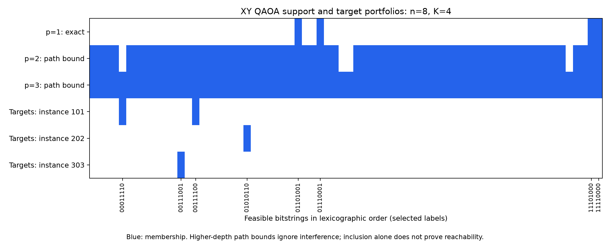
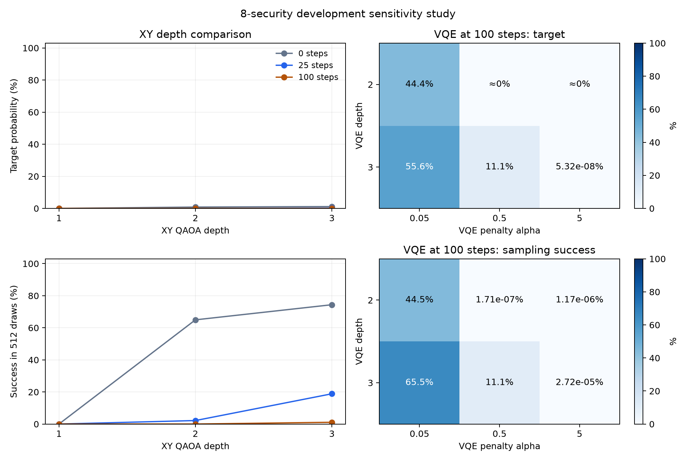
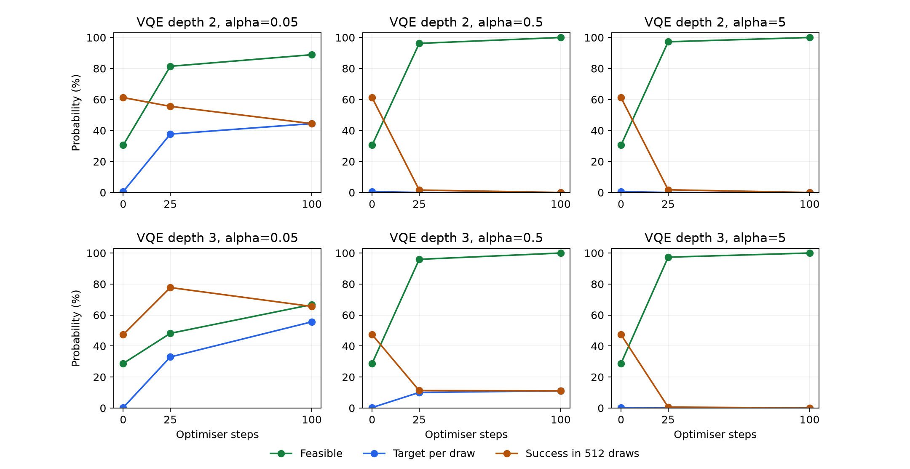

# Eight-security failure diagnostics

Completed 81 of 81 variant trajectories; 18 reuse frozen baseline trajectories, verified against the current production circuit.

## XY support and parameter roles

At depth 1 the diagonal cost layer acts on a single computational-basis initial portfolio and contributes only a global phase. Gamma cannot change the output probabilities. The exact mixer amplitudes are saved as integer Laurent polynomials in z=exp(2i beta), divided by 2 to the number of ordered exchange edges. Each exchange has stay amplitude (z+z^-1)/2 and swap amplitude (z^-1-z)/2. Exact integer cancellation identifies the support over all beta, rather than inferring impossibility from a numerical grid.

For p>1 the gate-path support is an upper bound only: diagonal cost layers add no support, and each unequal exchange can stay or swap. Exclusion certifies unreachability; inclusion does not prove reachability because tied parameters and interference may reduce support. The first gamma remains globally redundant at all depths, while later gammas can affect the distribution. parameter_sensitivity.csv records finite +0.1 perturbation probes at fixed generic parameters generated with seed 314+depth; these probes supplement the analytic argument.

| Instance | Depth | Support kind | Support count | Targets covered / all |
| ---: | ---: | --- | ---: | ---: |
| 101 | 1 | exact_laurent | 4 | 0 / 2 |
| 101 | 2 | gate_path_upper_bound | 66 | 1 / 2 |
| 101 | 3 | gate_path_upper_bound | 70 | 2 / 2 |
| 202 | 1 | exact_laurent | 4 | 0 / 1 |
| 202 | 2 | gate_path_upper_bound | 66 | 1 / 1 |
| 202 | 3 | gate_path_upper_bound | 70 | 1 / 1 |
| 303 | 1 | exact_laurent | 4 | 0 / 1 |
| 303 | 2 | gate_path_upper_bound | 66 | 1 / 1 |
| 303 | 3 | gate_path_upper_bound | 70 | 1 / 1 |

## Penalty adequacy and VQE expressivity

The strict sufficient penalty is alpha > max over infeasible x of (f_star-f(x))/(sum(x)-K)^2, clipped below at zero. Exhaustive floating-point enumeration supplies this numerical threshold and the penalised ground-state feasibility check. A sufficient penalty guarantees the global penalised optimum is feasible; it does not guarantee Adam finds it. VQE can represent every basis portfolio at either tested depth: set the first RY layer to pi*x and the remaining rotations to zero; CZ gates change phases only. Target-state constructions and their measured probabilities are saved separately from training and are never supplied to the optimiser.

| Instance | Alpha | Critical alpha | Strict sufficient | All numerical minimisers feasible |
| ---: | ---: | ---: | --- | --- |
| 101 | 0.05 | 0.02923 | True | True |
| 101 | 0.5 | 0.02923 | True | True |
| 101 | 5 | 0.02923 | True | True |
| 202 | 0.05 | 0.0638523 | False | False |
| 202 | 0.5 | 0.0638523 | True | True |
| 202 | 5 | 0.0638523 | True | True |
| 303 | 0.05 | 0.00977144 | True | True |
| 303 | 0.5 | 0.00977144 | True | True |
| 303 | 5 | 0.00977144 | True | True |

## Fixed-effort depth and penalty comparisons

All variants use the frozen original objectives, seeds, learning rates and 100-step effort (or the inherited source effort for a custom input). Changing depth changes parameter dimension and the production random initialisation; the same seed rule does not imply identical initial states across depths. Baselines reuse their historical distributions/timers; new variants run serially, so mixed historical runtimes are descriptive and not a speed comparison. No best-iterate selection, sampling, Top-K repair or held-out tuning occurs.

| Variant | Step | Target per draw | Feasible | Success: 16 draws | Success: 64 draws | Success: 512 draws | Valid / all |
| --- | ---: | ---: | ---: | ---: | ---: | ---: | ---: |
| xy-p1 | 100 | ≈0% | 100% | ≈0% | ≈0% | ≈0% | 9 / 9 |
| xy-p2 | 100 | 6.548e-10% | 100% | 1.048e-08% | 4.191e-08% | 3.353e-07% | 9 / 9 |
| xy-p3 | 100 | 0.00227% | 100% | 0.03627% | 0.1444% | 1.107% | 9 / 9 |
| vqe-d2-a0.05 | 100 | 44.44% | 88.89% | 44.44% | 44.45% | 44.45% | 9 / 9 |
| vqe-d2-a0.5 | 100 | 3.339e-10% | 100% | 5.343e-09% | 2.137e-08% | 1.71e-07% | 9 / 9 |
| vqe-d2-a5 | 100 | 2.285e-09% | 100% | 3.656e-08% | 1.463e-07% | 1.17e-06% | 9 / 9 |
| vqe-d3-a0.05 | 100 | 55.6% | 66.71% | 56.32% | 58.3% | 65.54% | 9 / 9 |
| vqe-d3-a0.5 | 100 | 11.11% | 99.99% | 11.11% | 11.11% | 11.11% | 9 / 9 |
| vqe-d3-a5 | 100 | 5.321e-08% | 100% | 8.514e-07% | 3.406e-06% | 2.725e-05% | 9 / 9 |

## Convergence diagnostics and interpretation

vqe_modes.csv records the final modal portfolio, its feasibility/objective gap, exact best one-for-one swap improvement, and final analytic energy-gradient norm. Gradient norms are descriptive, not local-optimum certificates. When an improving swap exists, the stored product-state path rotates the removed/added bits together: with u=sin^2(pi*t/2), its energy is f0+linear*u+quadratic*u^2. The computed maximum rise illustrates that particular path; it is not a lower bound on all entangled circuit paths or proof of a trapping mechanism.

Means average seeds within each instance and then give instances equal weight. Success probabilities use each run's exact target mass before the nonlinear iid draw calculation. Failures remain in all counts and have blank metrics. Method labels in summary/checkpoint tables are variant identifiers. raw trajectories and static_analysis.json retain parameters, distributions, exact support coefficients and construction evidence. The beta grid is exploratory; its maximum is not a certified global maximum unless exact support excludes every target.

These are small development-instance diagnostics, not held-out evidence of tuned performance, confidence intervals, scaling laws or quantum advantage. Penalty strengths are algorithm settings; returned quality always uses the same penalty-free feasible-portfolio objective. Approximately zero means below 1e-12 probability; percentages near certainty may round to 100%. CSVs retain full precision.

