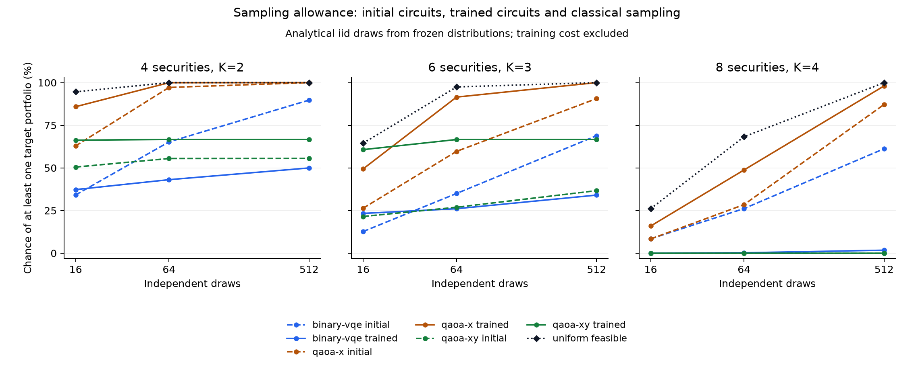

# Sampling allowance diagnostic

Analysed 81 saved initial/trained pairs at draw allowances 16, 64, 512, producing 243 paired allowance rows. No circuits were retrained and no random samples were drawn.

For each saved distribution, a success is a raw draw containing a feasible binary portfolio with original-objective normalised gap <= the frozen target (0.001 in this pilot). The chance of at least one success in m independent draws with replacement is `1 - (1 - p)^m`. This is evaluated for each run before averaging over seeds within each instance and then equally over instances. Training changes are paired within each run before aggregation.

Every raw quantum draw counts, including infeasible bitstrings. No feasibility conditioning, postselection or Top-K repair is applied. Uniform classical sampling draws exact-K subsets uniformly with replacement; its single-draw probability is the target subset count divided by the feasible subset count. Its baseline is evaluated once per instance and allowance, independently of quantum method/seed counts.

| Securities | K | Method | Draws | Initial success | Trained success | Change (percentage points) | Uniform feasible (matched coverage) | Valid pairs / all |
| ---: | ---: | --- | ---: | ---: | ---: | ---: | ---: | ---: |
| 4 | 2 | binary-vqe | 16 | 34.16% | 37.29% | +3.125 | 94.59% | 9 / 9 |
| 4 | 2 | binary-vqe | 64 | 65.24% | 43.09% | -22.15 | 100% | 9 / 9 |
| 4 | 2 | binary-vqe | 512 | 89.74% | 49.96% | -39.78 | 100% | 9 / 9 |
| 4 | 2 | qaoa-x | 16 | 62.9% | 85.88% | +22.98 | 94.59% | 9 / 9 |
| 4 | 2 | qaoa-x | 64 | 97.16% | 99.95% | +2.784 | 100% | 9 / 9 |
| 4 | 2 | qaoa-x | 512 | 100% | 100% | +8.623e-09 | 100% | 9 / 9 |
| 4 | 2 | qaoa-xy | 16 | 50.49% | 66.25% | +15.76 | 94.59% | 9 / 9 |
| 4 | 2 | qaoa-xy | 64 | 55.5% | 66.67% | +11.16 | 100% | 9 / 9 |
| 4 | 2 | qaoa-xy | 512 | 55.56% | 66.67% | +11.11 | 100% | 9 / 9 |
| 6 | 3 | binary-vqe | 16 | 12.7% | 23.33% | +10.63 | 64.48% | 9 / 9 |
| 6 | 3 | binary-vqe | 64 | 34.99% | 26.07% | -8.921 | 97.46% | 9 / 9 |
| 6 | 3 | binary-vqe | 512 | 68.85% | 34.05% | -34.81 | 100% | 9 / 9 |
| 6 | 3 | qaoa-x | 16 | 26.37% | 49.43% | +23.05 | 64.48% | 9 / 9 |
| 6 | 3 | qaoa-x | 64 | 59.68% | 91.5% | +31.82 | 97.46% | 9 / 9 |
| 6 | 3 | qaoa-x | 512 | 90.62% | 100% | +9.383 | 100% | 9 / 9 |
| 6 | 3 | qaoa-xy | 16 | 21.52% | 60.71% | +39.19 | 64.48% | 9 / 9 |
| 6 | 3 | qaoa-xy | 64 | 26.93% | 66.63% | +39.71 | 97.46% | 9 / 9 |
| 6 | 3 | qaoa-xy | 512 | 36.66% | 66.67% | +30.01 | 100% | 9 / 9 |
| 8 | 4 | binary-vqe | 16 | 8.446% | 0.05893% | -8.387 | 26.08% | 9 / 9 |
| 8 | 4 | binary-vqe | 64 | 26.15% | 0.2339% | -25.92 | 68.24% | 9 / 9 |
| 8 | 4 | binary-vqe | 512 | 61.23% | 1.74% | -59.49 | 99.96% | 9 / 9 |
| 8 | 4 | qaoa-x | 16 | 8.344% | 15.92% | +7.576 | 26.08% | 9 / 9 |
| 8 | 4 | qaoa-x | 64 | 28.48% | 48.79% | +20.31 | 68.24% | 9 / 9 |
| 8 | 4 | qaoa-x | 512 | 87.15% | 98.03% | +10.88 | 99.96% | 9 / 9 |
| 8 | 4 | qaoa-xy | 16 | <1e-10% | <1e-10% | +2.789e-65 | 26.08% | 9 / 9 |
| 8 | 4 | qaoa-xy | 64 | <1e-10% | <1e-10% | +1.115e-64 | 68.24% | 9 / 9 |
| 8 | 4 | qaoa-xy | 512 | <1e-10% | <1e-10% | +8.923e-64 | 99.96% | 9 / 9 |

## Uniform feasible baseline across all source instances

| Securities | K | Draws | Instances | Success probability |
| ---: | ---: | ---: | ---: | ---: |
| 4 | 2 | 16 | 3 | 94.59% |
| 4 | 2 | 64 | 3 | 100% |
| 4 | 2 | 512 | 3 | 100% |
| 6 | 3 | 16 | 3 | 64.48% |
| 6 | 3 | 64 | 3 | 97.46% |
| 6 | 3 | 512 | 3 | 100% |
| 8 | 4 | 16 | 3 | 26.08% |
| 8 | 4 | 64 | 3 | 68.24% |
| 8 | 4 | 512 | 3 | 99.96% |

Probabilities are analytical expectations, not observed hit fractions or new stochastic trials. In particular, a mean single-draw probability is never substituted into the nonlinear success formula. Near-100% entries may round to 100%; full precision is retained in CSVs. Values below 1e-10% are displayed as an upper bound. Markers in the plot show the evaluated allowances; connecting lines guide the eye.

Complete source checkpoints are required. Failed source pairs remain as blank probabilities and error counts; probability means condition on valid source pairs, with quality_instance_count and successful_pairs reporting coverage. The matched classical column uses the same successful-pair coverage, while baseline_summary.csv uses all source instances. With failures, model and all-instance baseline curves can have different coverage and must be interpreted conditionally.

The formula assumes a fixed distribution and independent draws with replacement. It does not model device noise, drift or adaptive sampling. Draw counts do not equalise runtime or cost: training, circuit preparation, measurements and classical candidate processing are excluded. This is a sampling-reliability comparison, not a quantum-advantage or time-to-solution result. The pilot contains only three independent instances per size and three initialisations per method; no confidence intervals or scaling claims are made.

manifest.json hashes both source evidence files and records the analysis settings, software and source versions. pairs.csv preserves per-run allowance probabilities and paired changes. baseline_trials.csv contains one classical row per instance/allowance. summary.csv and baseline_summary.csv contain descriptive means.

