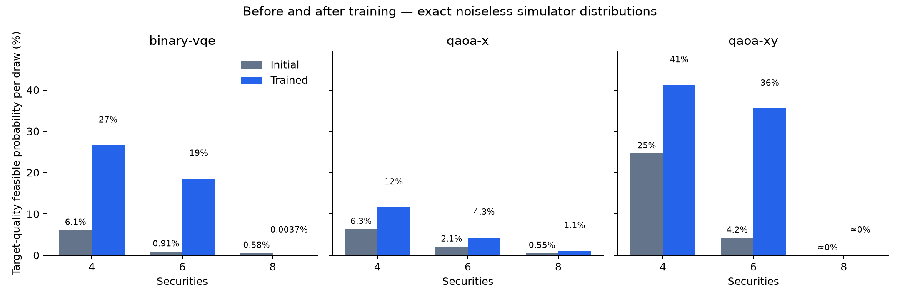

# Before-and-after training diagnostic

Completed 81 of 81 planned initial/trained pairs.

Each pair uses the same frozen binary problem, circuit, initial parameters and seed. Training settings are inherited from the pilot (25 Adam steps in the default experiment). Initial means random parameters before any optimiser update, with the full circuit applied. Trained means the final parameters after all updates; no best-iterate selection is used.

The primary measure is the exact single-draw probability of a feasible portfolio with normalised original-objective gap <= the configured target_gap (0.001 in the pilot). It is not a 512-sample hit rate or a postprocessed portfolio score. No samples or Top-K repairs are used. Reference scores are used only by the evaluator, never by training.

| Securities | K | Method | Successful pairs / all | Initial P(target) | Trained P(target) | Change (percentage points) | Improved pairs | Worsened pairs | Initial P(feasible) | Trained P(feasible) |
| ---: | ---: | --- | ---: | ---: | ---: | ---: | ---: | ---: | ---: | ---: |
| 4 | 2 | binary-vqe | 9 / 9 | 6.124% | 26.65% | +20.53 | 4 | 5 | 24.05% | 97.78% |
| 4 | 2 | qaoa-x | 9 / 9 | 6.346% | 11.64% | +5.29 | 8 | 1 | 36.67% | 74.7% |
| 4 | 2 | qaoa-xy | 9 / 9 | 24.64% | 41.17% | +16.53 | 5 | 1 | 100% | 100% |
| 6 | 3 | binary-vqe | 9 / 9 | 0.9142% | 18.53% | +17.62 | 4 | 5 | 34.2% | 97.4% |
| 6 | 3 | qaoa-x | 9 / 9 | 2.075% | 4.312% | +2.236 | 8 | 1 | 24.83% | 61.11% |
| 6 | 3 | qaoa-xy | 9 / 9 | 4.226% | 35.55% | +31.33 | 5 | 1 | 100% | 100% |
| 8 | 4 | binary-vqe | 9 / 9 | 0.5765% | 0.003692% | -0.5728 | 0 | 9 | 30.52% | 97.22% |
| 8 | 4 | qaoa-x | 9 / 9 | 0.5499% | 1.09% | +0.5401 | 9 | 0 | 27.46% | 55.63% |
| 8 | 4 | qaoa-xy | 9 / 9 | 1.03e-67% | 1.846e-66% | +1.743e-66 | 0 | 0 | 100% | 100% |

Metrics average seeds within each instance, then give instances equal weight. Paired changes are computed within runs before aggregation. Improved/worsened counts use a numerical deadband of 1e-12 probability, not a statistical significance threshold. Failed pairs remain in the counts and are excluded from probability means; inspect error_count and quality_instance_count in summary.csv.

pairs.csv also reports P(target | feasible), expected penalised energy before/after, and uniform-bitstring/uniform-feasible single-draw reference probabilities. Conditional probabilities average per-run ratios, rather than ratios of pooled means. A circuit can improve feasibility or its penalised training energy while making target portfolios less likely.

The checkpoint pairs.json retains initial/final parameters, full probability vectors in computational-basis order (wire 0 is the most significant bit), target basis indices, and actual solver configurations. The configured shots_sample value is inherited for traceability but is not used by this diagnostic. Sampling and depth/budget sweeps are outside this experiment. Fractional VQE returns an allocation rather than a sampled binary portfolio and is outside this diagnostic.

These are exact evaluations of a noiseless simulator, not QPU measurements or evidence of computational advantage. Only three independent instances per size are used in the pilot, with three initialisation seeds each; no confidence intervals or scaling claims are made.

Plot labels below 1e-10% are shown as approximately zero; full precision is retained in the tables and checkpoint.
