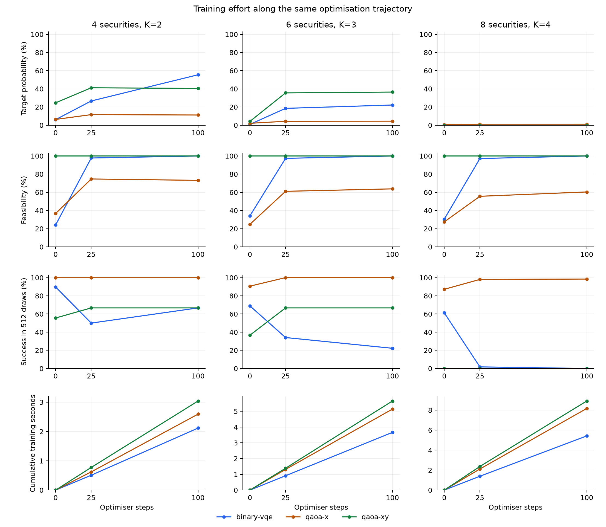
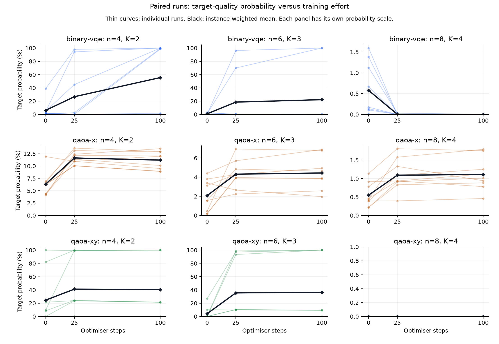

# Training-effort development study

Completed 81 of 81 planned trajectories at checkpoints 0, 25, 100.

Each trajectory initialises once and runs Adam continuously to the final step, preserving its moment estimates. Parameters and cumulative optimisation times are copied at the requested checkpoints. Exact noiseless distributions are evaluated only after optimisation has finished. No samples, Top-K repairs, best-iterate selection or held-out tuning are used.

The frozen problems, initialisation seeds, depths, penalties, learning rates and quality target are inherited from the prior diagnostic. When available, the initial and original training-step parameters/probabilities must match that evidence; a mismatch is recorded as a trajectory error.

| Securities | K | Method | Step | Target probability | Feasibility | Success: 16 draws | Success: 64 draws | Success: 512 draws | Training seconds | Valid / all |
| ---: | ---: | --- | ---: | ---: | ---: | ---: | ---: | ---: | ---: | ---: |
| 4 | 2 | binary-vqe | 0 | 6.124% | 24.05% | 34.16% | 65.24% | 89.74% | 0 | 9 / 9 |
| 4 | 2 | binary-vqe | 25 | 26.65% | 97.78% | 37.29% | 43.09% | 49.96% | 0.50787 | 9 / 9 |
| 4 | 2 | binary-vqe | 100 | 55.5% | 100% | 58.29% | 63.08% | 66.67% | 2.1168 | 9 / 9 |
| 4 | 2 | qaoa-x | 0 | 6.346% | 36.67% | 62.9% | 97.16% | 100% | 0 | 9 / 9 |
| 4 | 2 | qaoa-x | 25 | 11.64% | 74.7% | 85.88% | 99.95% | 100% | 0.62146 | 9 / 9 |
| 4 | 2 | qaoa-x | 100 | 11.2% | 73.17% | 84.36% | 99.9% | 100% | 2.5929 | 9 / 9 |
| 4 | 2 | qaoa-xy | 0 | 24.64% | 100% | 50.49% | 55.5% | 55.56% | 0 | 9 / 9 |
| 4 | 2 | qaoa-xy | 25 | 41.17% | 100% | 66.25% | 66.67% | 66.67% | 0.77328 | 9 / 9 |
| 4 | 2 | qaoa-xy | 100 | 40.48% | 100% | 65.97% | 66.67% | 66.67% | 3.0405 | 9 / 9 |
| 6 | 3 | binary-vqe | 0 | 0.9142% | 34.2% | 12.7% | 34.99% | 68.85% | 0 | 9 / 9 |
| 6 | 3 | binary-vqe | 25 | 18.53% | 97.4% | 23.33% | 26.07% | 34.05% | 0.91099 | 9 / 9 |
| 6 | 3 | binary-vqe | 100 | 22.21% | 100% | 22.22% | 22.22% | 22.22% | 3.6599 | 9 / 9 |
| 6 | 3 | qaoa-x | 0 | 2.075% | 24.83% | 26.37% | 59.68% | 90.62% | 0 | 9 / 9 |
| 6 | 3 | qaoa-x | 25 | 4.312% | 61.11% | 49.43% | 91.5% | 100% | 1.3116 | 9 / 9 |
| 6 | 3 | qaoa-x | 100 | 4.436% | 63.81% | 50.07% | 91.18% | 100% | 5.1364 | 9 / 9 |
| 6 | 3 | qaoa-xy | 0 | 4.226% | 100% | 21.52% | 26.93% | 36.66% | 0 | 9 / 9 |
| 6 | 3 | qaoa-xy | 25 | 35.55% | 100% | 60.71% | 66.63% | 66.67% | 1.3864 | 9 / 9 |
| 6 | 3 | qaoa-xy | 100 | 36.47% | 100% | 59.79% | 66.61% | 66.67% | 5.6499 | 9 / 9 |
| 8 | 4 | binary-vqe | 0 | 0.5765% | 30.52% | 8.446% | 26.15% | 61.23% | 0 | 9 / 9 |
| 8 | 4 | binary-vqe | 25 | 0.003692% | 97.22% | 0.05893% | 0.2339% | 1.74% | 1.3886 | 9 / 9 |
| 8 | 4 | binary-vqe | 100 | 2.285e-09% | 100% | 3.656e-08% | 1.463e-07% | 1.17e-06% | 5.4202 | 9 / 9 |
| 8 | 4 | qaoa-x | 0 | 0.5499% | 27.46% | 8.344% | 28.48% | 87.15% | 0 | 9 / 9 |
| 8 | 4 | qaoa-x | 25 | 1.09% | 55.63% | 15.92% | 48.79% | 98.03% | 2.1134 | 9 / 9 |
| 8 | 4 | qaoa-x | 100 | 1.11% | 60.41% | 16.18% | 49.39% | 98.42% | 8.1679 | 9 / 9 |
| 8 | 4 | qaoa-xy | 0 | <1e-10% | 100% | <1e-10% | <1e-10% | <1e-10% | 0 | 9 / 9 |
| 8 | 4 | qaoa-xy | 25 | <1e-10% | 100% | <1e-10% | <1e-10% | <1e-10% | 2.3643 | 9 / 9 |
| 8 | 4 | qaoa-xy | 100 | <1e-10% | 100% | <1e-10% | <1e-10% | <1e-10% | 8.9145 | 9 / 9 |

Means give seeds equal weight within each instance, then give instances equal weight. Success probabilities use 1-(1-p)^m per run before averaging, counting all raw draws including infeasible ones. The target is a feasible portfolio within the frozen normalised objective-gap tolerance (0.001 in the pilot). Paired changes for every checkpoint interval are in paired_summary.csv; improved/worsened counts use a numerical 1e-12 probability deadband, not a significance test.

Training time is cumulative wall time within the Adam loop, including callback/logging overhead and excluding problem encoding, device setup, diagnostic probability evaluation, sampling and portfolio postprocessing. Step zero has zero optimiser time. These descriptive simulator timings are not a common end-to-end budget or QPU measurement.

Failed trajectories remain in counts and have blank checkpoint metrics; probability means use complete successful trajectories only, with coverage explicit in quality_instance_count and successful_trajectories. Resume skips completed trajectories, including errors. Interrupted trajectories restart from their original seed; parameter snapshots alone are not treated as resumable Adam state.

This is development sensitivity analysis on the existing small instance set. It provides no confidence intervals, held-out evaluation, scaling law or quantum-advantage claim. More training can improve the penalty energy or feasibility without improving target probability. Connecting plot lines link evaluated checkpoints rather than showing every intermediate iterate. Plot values below 1e-12 probability are displayed as zero; full precision is retained in the data.

